# Progress: Super Mario Bros. Wonder, NVN → Vulkan on macOS

Living log, newest first. The plan is [docs/NVN.md](docs/NVN.md); what we learn about the game is in
[docs/nvn/WONDER.md](docs/nvn/WONDER.md). Hades is out of scope for this track (it is done on PC and focused on
Android elsewhere).

**Target:** Wonder 1.0.0 (010015100B514000) running natively on the Mac (Apple M1, 16 GB, macOS 14), CPU recompiled,
NVN implemented over Vulkan (MoltenVK).

## Status by phase

| Phase | Issue | State |
|---|---|---|
| N0 shared core, per-game layout, probe | #7 | done for this track (Windows/Hades items left, not needed here) |
| N1 CPU side: recompile, boot to `nvnBootstrapLoader` | #8 | **done**: the game runs its frame loop on macOS (2,000+ frames, no crash) |
| N2 NVN reconnaissance (tracer, API.md) | #9 | **mostly done**: tracer, driver addresses of all 534 procs, device info, signatures of the procs in use; API.md to write |
| N3 device, pools, sync, window (first NVN pixel) | #10 | **done**: MoltenVK device, swapchain, window textures presented, clears replayed (dark grey = never drawn) |
| N4 textures and samplers | #11 | **working**: untiling + upload (BNTX block heights), ASTC/BCn, samplers, swizzles, views (levels/layers) |
| N5 Maxwell shaders → SPIR-V | #12 | **done**: 12,717/12,717 blocks offline + the 34 embedded in main; runtime cache by hash |
| N6 pipeline state and draws | #13 | **working**: pipelines, descriptor sets, dynamic rendering, texture views; **the title screen renders correctly** |
| N7 whole game, performance | #14 | not started |
| NA AudioRenderer (`audren:u`) | — (new) | **renders in process** (the sdk's own server + DSP code, DFC); output to the Mac next |

## Log

### 2026-09-30 (night): 60 fps in menus, the course at ~30 fps

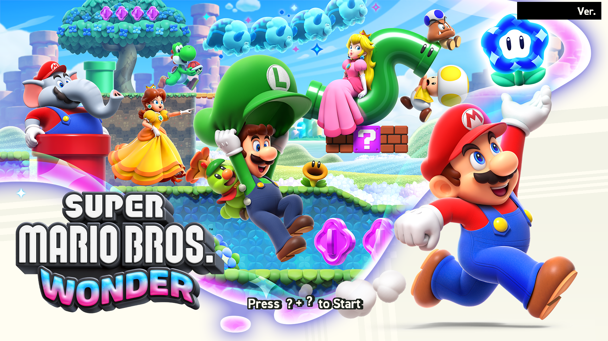
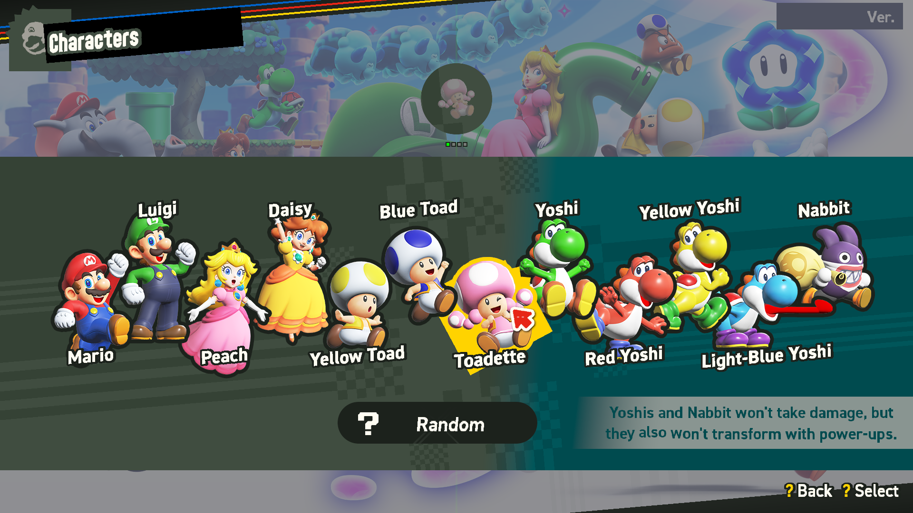
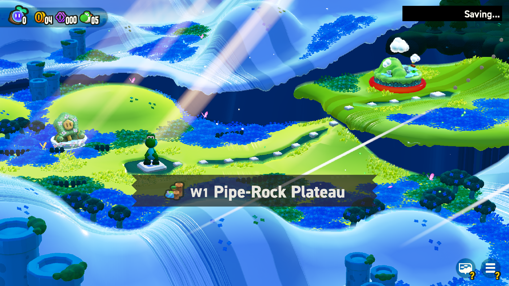
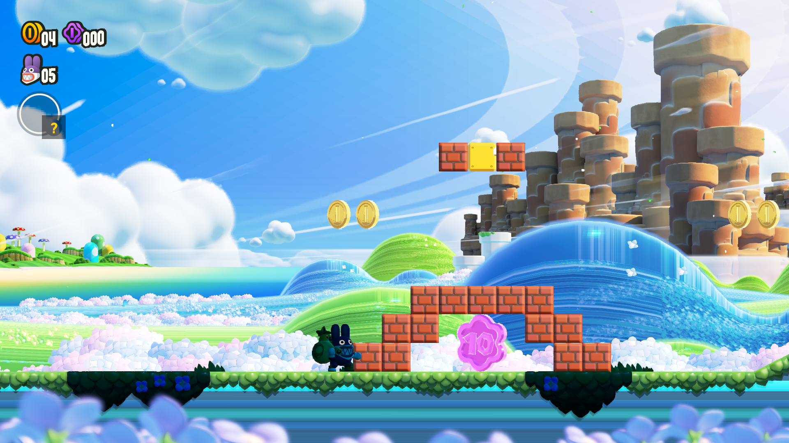

- **Speed.**
  - Title, menus, character select and the world map run at 55-60 fps; they were at ~15 fps yesterday.
  - The first course runs at 30-44 fps.
  - Changes (docs/nvn/DEBUG.md #30-#37):
    - uploads reused within a submit (60 → 12 MB per frame);
    - clears inside render passes;
    - missing pool textures no longer end the render pass (1.4 M breaks per run);
    - the kernel's spin naps limited to Hades (the job system's yields cost 1 ms each);
    - game threads at interactive QoS;
    - a frame limiter at the window's present interval;
    - mailbox present;
    - one texture resolution per draw.
- **Rendering fixes.**
  - Characters: the 2D menu art and the 3D models on the map render with the right colours.
  - Live textures over the same memory share one image (#36).
  - Stencil reference and masks, depth bias and depth clamp are applied (#38).
  - Review fixes: host scratch data is not shared between draws, and clears honour their masks and sizes.
- **Open.**
  - The course's actors render dark (#39): they sample the AO and ambient-light targets of another frame.
  - The course is at ~30 fps: the game switches its present interval between 1 and 2, and the frame is ~23 ms of
    replay plus GPU.
  - Tried and kept off by default, documented: the replay thread (#40), Deferred binds (#41), kept pool textures (#38).

### 2026-09-29 (night): real colours, two crashes fixed

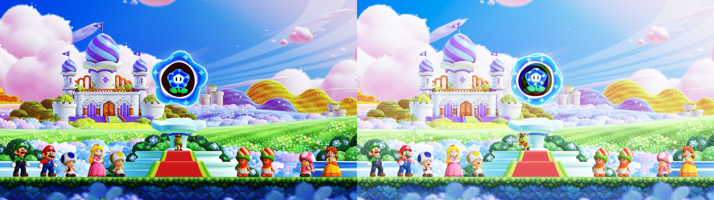
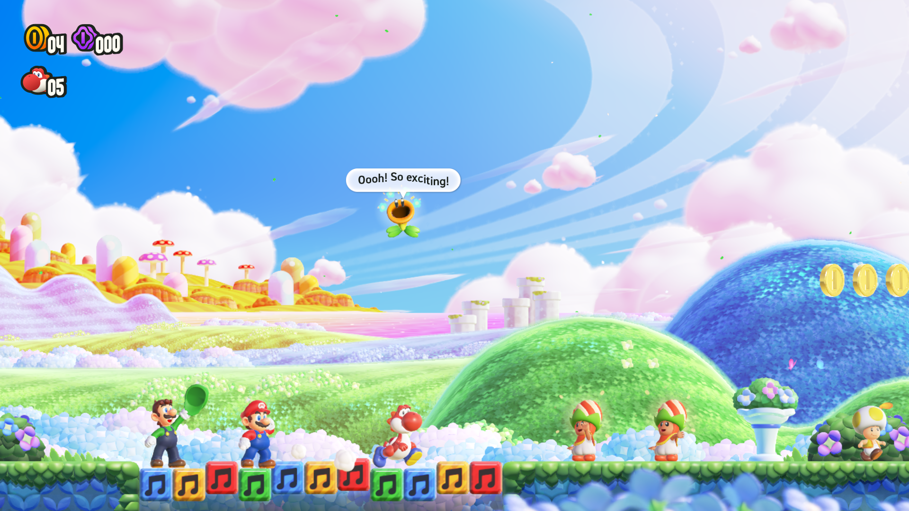
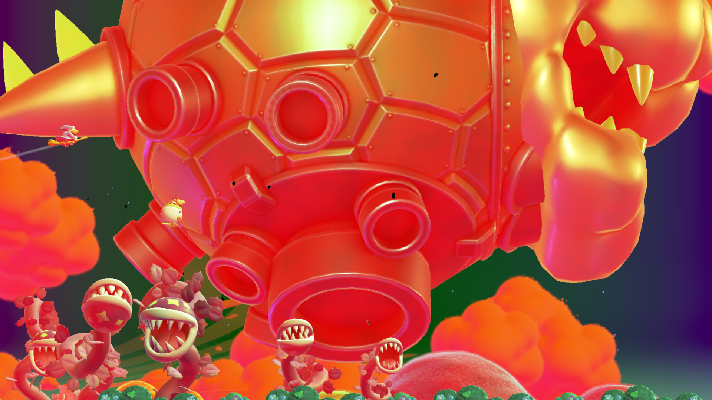

- Milestones W1 (stability), W2 (colour), W3 (60 fps) and W4 (glitches) on GitHub, issues #15-#25, from the study
  docs/nvn/STUDY-colour-speed-glitches.md.
- **Colours match the real game** (DEBUG.md #29): NVN sRGB texture views are now honoured. Mean luma 0.756 against
  0.748 on the same shot.
- **Crashes**: texture mip levels clamped (#27, a Metal abort after Bowser arrives), and audio updates paced to renders
  (#28, a LightLimiter never initialized). Runs now reach Bowser's castle transformation.

### 2026-09-29 (evening): Mario and every character appear

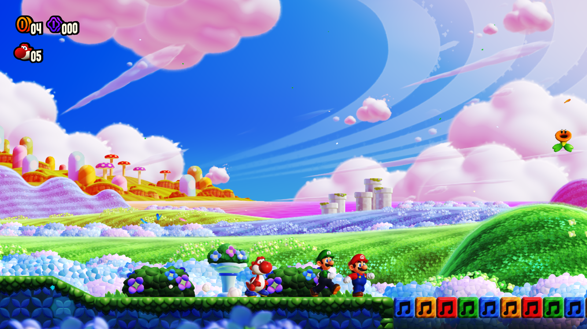
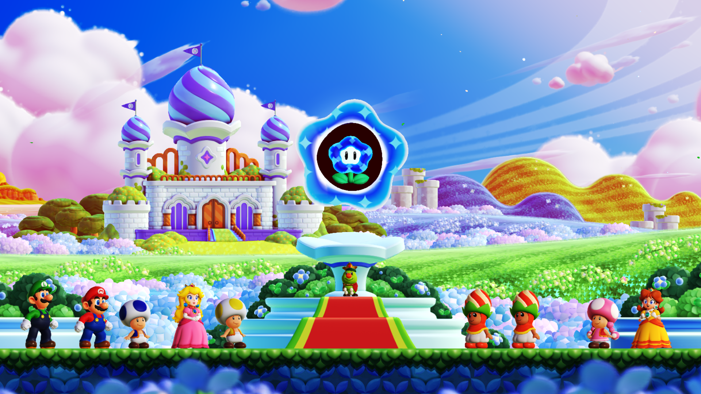
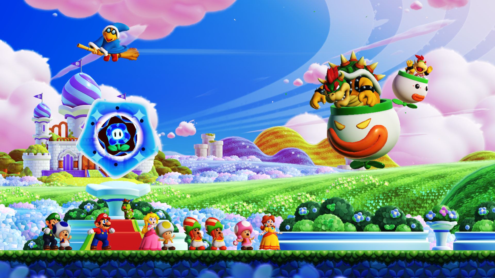

- **Characters render.** Two bugs hid them (docs/nvn/DEBUG.md #26): Metal refused every skinned pipeline (integer
  bone-index inputs declared as float; the integer input patch is now on by default), and the per-mesh draw lists the
  characters use, recorded when the course loads, were dropped by our command-handle limit before the game first
  called them. Handles now live as long as their command memory.
- New debug tools: `NX_ZERO_DRAWS` (occlusion query per draw), `NX_TRACE_SKIN`, `NX_TRACE_SKINLISTS`.
- Studied in parallel by four read-only agents (shader classification, emulator research, CPU-side draw issue, GPU
  sync/state audit). Found for later: stencil reference and masks are stubs, a stencil-only clear also clears depth,
  polygon offset and depth bounds are ignored.

### 2026-09-29 (afternoon): sound on the Mac, right-side-up course, 793 shaders fixed

- **Audio plays on the Mac's speakers.** The AudioRenderer's final mix is a DeviceSink command that the SDK's DSP
  command processor skips in CPU mode (the ADSP does it on the console); an HLE around
  `CommandListProcessor::Process` now reads the sink's mix buffers after each 5 ms frame, folds 6 channels to stereo
  and queues them to SDL3 (40-55 ms latency). A race between the game's sound thread and our render thread
  (`AudioRenderSystem::Update` vs command generation) is serialized. `NX_AUDIO_DUMP=file.wav` records 10 s.
- **The course was rendered upside down** since the beginning: NVN's upper-left origin maps NDC +Y to the top like D3D.
  Negative-height viewports now, NVN's front faces as is (DEBUG.md #17).
- **793 shaders were silently miscompiled** by the offline translator's SPIR-V back end (dropped `else if` chains):
  the dialog text among them. Patched in the harness and regenerated (DEBUG.md #18, TRANSLATOR.md).
- Two investigations ran in parallel with the main line (the translator and the audio output) while the orientation
  bug was being found; the approach works and will continue.

### 2026-09-29 (late morning): the opening cutscene plays in 3D

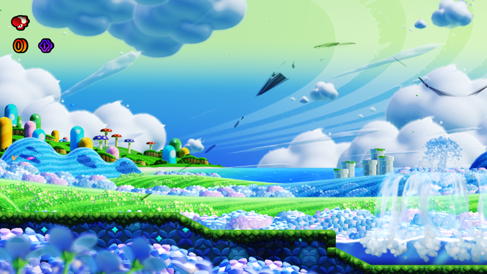
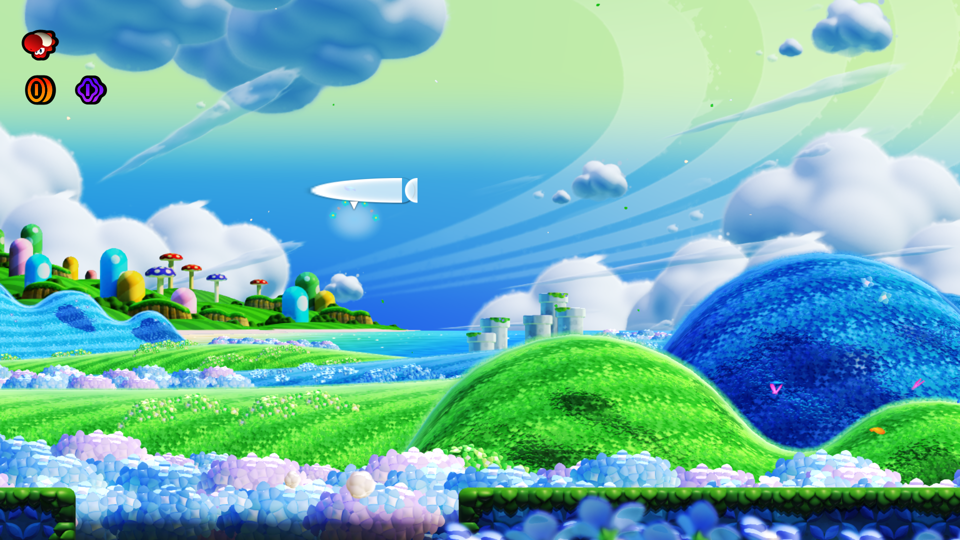
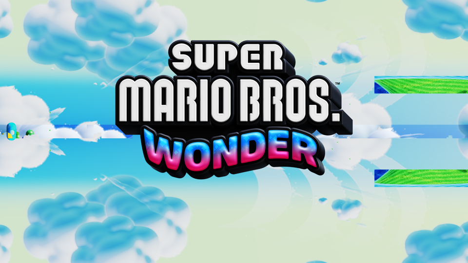

- The opening now runs past its dialogs: Peach's voice, the party timeline music, Kamek's airship flying over the
  Flower Kingdom, the logo. The recompiler fix that got it there: a jump table whose base register comes from another
  control-flow path (DEBUG.md #16). Memory stays under 4.6 GB.
- Some frames alternate with the sky/mirrored view (to look at), dialog text still invisible.

### 2026-09-29 (morning): character select, the opening, audio, a memory leak fixed

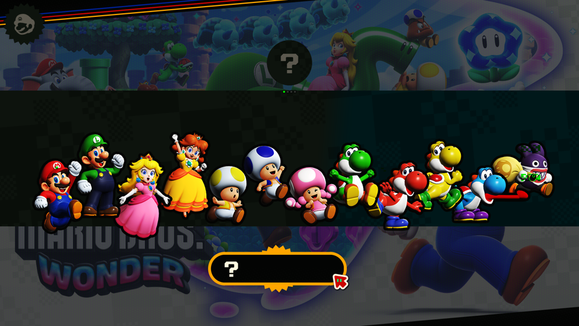
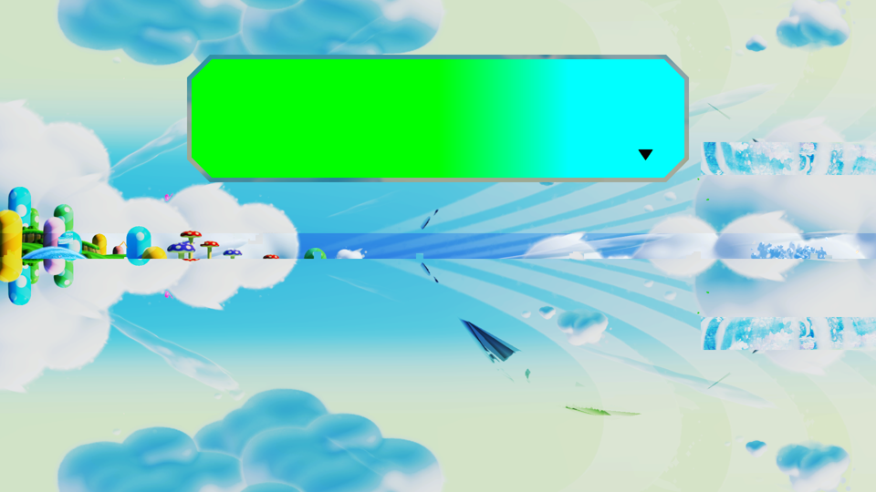
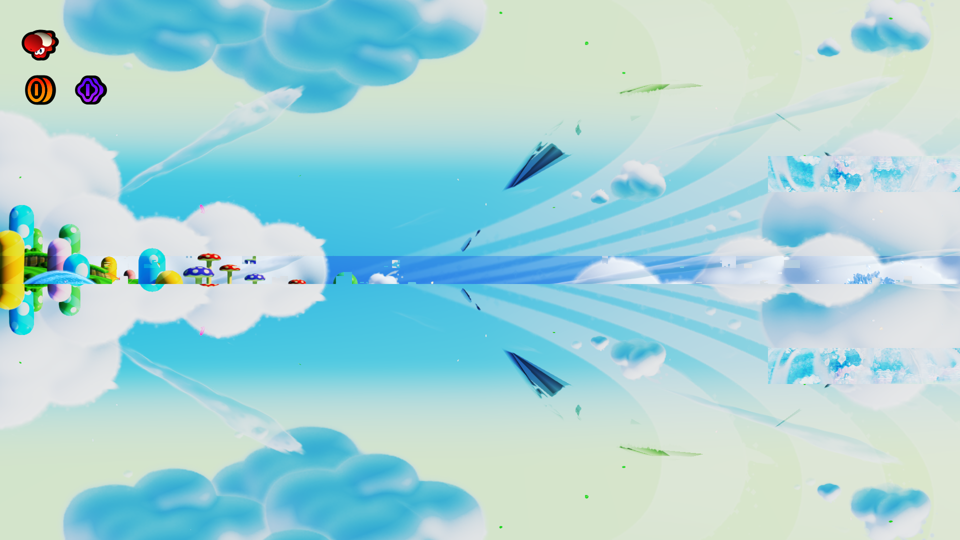

- **Title → file select → player count → character select → confirmation → opening cutscene → HUD.** Menus need
  A held ~1 s (short presses were missed); the opening dialogs advance with repeated/long presses.
- **NVN coverage**: plural and deferred binds, viewports/scissors/depth ranges, rasterizer discard and render
  enable, `CopyTextureToTexture` (copy or blit), `DispatchCompute[Indirect]` with storage images, `c[0]` driver
  constants (the buffer descriptor table compute shaders search; a zero table made them write garbage), texture
  writes (`WriteTexels`), CPU-written textures re-uploaded (flushes, pitch-linear content hashes), long-lived command
  lists kept (LRU), uniform/storage padding (Metal has no bounds checks), 256 MB upload buffer.
- **Audio renders**: the in-process AudioRenderer only renders in the manual/CPU mode; switched after opening, frames
  take ~250 us and streamed music is consumed (the opening waited for it).
- **Memory leak that froze the Mac (85 GB)**: images of destroyed textures were never freed. Fixed (freed at the next
  submit); the same run now stays at ~4.5 GB. A **memory guard** ends the process past `NX_MEM_LIMIT_GB` (default 8).
- **Headless test runs** (`NX_HEADLESS=1`): no window, nothing presented, frames still dumped.
- Open: dialog text is invisible (the glyph vertex shader's corner-indexed texture-coordinate load was only partly
  resolved by the offline translator); the dialog box shows a green-cyan gradient; a second recompiler jump-table case
  (table base defined on another control-flow path) crashed after the HUD, fixed in the recompiler.

### 2026-09-29 (early morning): 30 fps, past the title to the file select

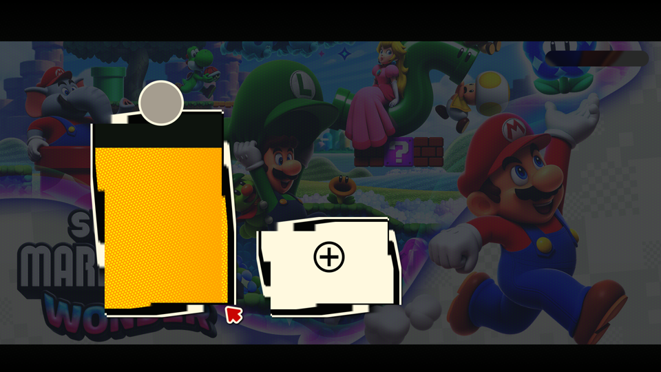

- **Performance: from 2-3 fps to the game's 30 fps.** 8-bit index buffers were converted by MoltenVK on the GPU at
  every draw (~10 ms each, ~550 ms per frame); they are widened on the host now. GPU ~10 ms per frame on the title.
  Found with a process sample (all threads waiting on the GPU fence), a per-pass GPU profiler (`NX_GPU_PROFILE`) and
  elimination (no draw calls: fast; no rasterization: still slow). docs/nvn/DEBUG.md #7.
- **Recompiler bug fixed**: a jump table bounded by an unrelated `cmp` lost a case (crash after the title, "call into
  the middle of a function"). Regenerating now rewrites only the files that change: rebuild in 25 s. DEBUG.md #8.
- **A works: the file select opens** (save card, new-file card, cursor). Text rendering is still broken (green
  specks where text should be). Scripted input for unattended runs: `NX_INPUT_SCRIPT="25:A:0.3;30:A:0.3"`.
- Metal-incompatible texture views (a cube view of a 2D texture) fall back to the dummy instead of aborting.

### 2026-09-28 (night, latest): the title screen, correct colours

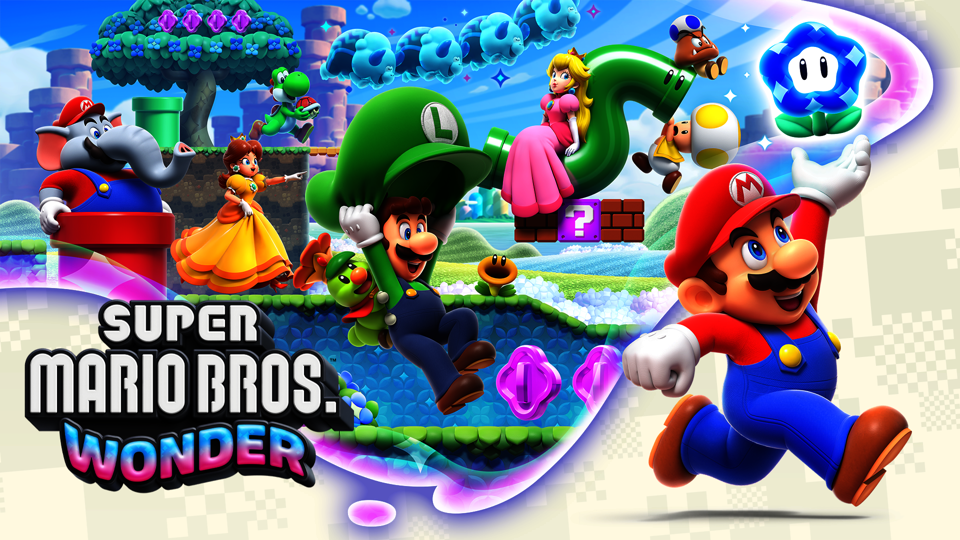

- **The title screen renders correctly on the Mac**: recompiled CPU code + NVN replayed on Vulkan/MoltenVK, colours
  exact (a texel of the key art: 60,196,130 in the texture, 60,195,128 on screen after the post chain).
- Last fix: texture views. The bloom chain renders each mip of one texture while sampling the previous one; NVN picks
  the level with the `NVNtextureView` of `SetRenderTargets` and of the texture pool. Without it everything went to
  level 0, uninitialised levels were sampled, R and B became NaN and the screen green. Now attachments are per
  level/layer, rendered images stay `GENERAL`, 3D images are 2D-array compatible (the LUT is rendered by slice).
- Still slow (~2-3 fps on the title): every submit waits for the GPU, descriptor sets and uploads are redone per draw.

### 2026-09-28 (night, later): the title screen through Vulkan

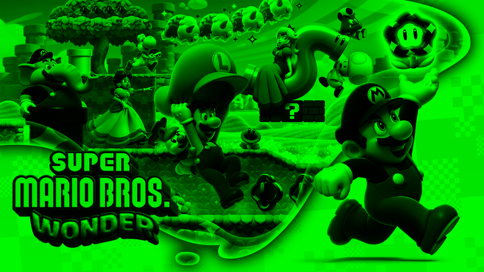

- **The title art renders natively** (M1, MoltenVK): the Super Mario Bros. Wonder key art, logo and checkered
  background come out of the game's own NVN command lists, replayed as Vulkan draws with the translated shaders. The
  remaining defect is colour: R and B are NaN from the bloom chain (render-target views not implemented yet).
- Six bugs found on the way, each with its screenshot and how it was found: [docs/nvn/DEBUG.md](docs/nvn/DEBUG.md).
  In short: command-memory usage must survive `EndRecording` (the engine dropped every scene list), the front face is
  inverted under the upper-left origin (the composite was culled: magenta), packaged textures use the survey's
  block-height fit (the builder's layout is always 1), channel-mask outputs are 4-byte words, texture swizzles
  (builder and pool view) are applied.
- Recorded vs replayed draws now match (6,368 recorded, 6,492 replayed including re-submitted lists).
- `ReportCounter` writes {counter, timestamp} at replay; timestamps are host nanoseconds (the conversions are
  identities).
- New debug switches (texture dumps at any point, raw texels, per-target draw traces with state, texture traces):
  table in docs/nvn/DEBUG.md.
- Slow: ~3-4 fps once the title scene runs (synchronous replay, every submit waits for the GPU). N7.

### 2026-09-28 (late night): Vulkan on the Mac, shaders translated

- **Shader translation settled (decision 2):** Ryujinx's MIT translator run offline (tools/maxwell/spirv_harness):
  all 12,717 distinct Maxwell blocks (47,797 stages) become SPIR-V that passes spirv-val and compiles to Metal on
  the M1. docs/nvn/TRANSLATOR.md has NVN's constant-bank layout (c[0] driver, c[1] constants, c[2] texture
  handles, c[3+n] uniform blocks) and the descriptor-set scheme.
- **First NVN frame path on Vulkan** (17c4c9c): MoltenVK device (portability), Metal surface, swapchain 2560x1440,
  a VkImage per NVN texture, recorded command lists replayed at submit, window textures blitted and presented.
  `NX_DUMP_FRAMES=N` writes every Nth presented texture to private/wonder/frames/ (the window can be behind).
- **Formats and enums from the driver:** the format table (0xa1 entries: color families, depth/stencil, sRGB, BCn,
  ASTC 4x4..12x12, BGR orders) mapped to VkFormat; NVN enums follow OpenGL's numbering from 1 (checked on Wonder's
  decoded states: blend 5/6, depth LEQUAL 4, sampler trilinear 5/1, wrap 1 repeat / 7 clamp to edge).
- **Draw recording** (31fc899, 53b66ef): programs, buffers, textures, vertex layouts, blend/color/mask/depth/polygon
  states decoded through the driver's getters while recording; samplers decoded the same way.
- In progress, in parallel: block-linear deswizzle (validated on the game's BNTX textures) and the runtime shader
  cache (hash -> SPIR-V, reflection, the translator's support buffer).

### 2026-09-28 (night): the frame loop runs (7c9aa0c)

Wonder boots on the Mac through every system and presents frames (`nvnQueuePresentTexture` #1..#32+, nothing on
screen yet: the Vulkan side is next). What it took, in boot order:
- **nn::init::Start** has an extra rtld callback in SDK 16; **VAMM** (nn::os virtual address memory) needs
  `svcGetInfo(SystemResourceSizeTotal)` = main.npdm's 16 MiB; `nn::vi::GetDisplayVsyncEvent` (60 Hz event).
- **NVN device info**: the 99 `nvnDeviceGetInteger` values read out of the SDK's own driver (jump tables at
  sdk+451090 / sdk+440c80); the game requires API 55.15.
- **Builders and state objects run in the SDK's own NVN driver** (recompiled), so their struct layout is exact;
  our objects read them back through its getters. Its texture storage size needs the GPU driver, so block-linear
  sizes are ours, from the driver's format table (sdk+d34198: block size and bytes per block per NVNformat).
- **nn::hid** SDK 16 calls, **nn::pl** shared fonts (the firmware's fonts need master_key_16, not in our keys: any
  TrueType font works because the game accepts already-decoded BFTTF data; the Mac's Arial Unicode for now).
- **Programs**: `NVNshaderDataExt` = {code GPU address, control section pointer, 0} (0x18 bytes).
- **Audio without writing a renderer**: the sdk carries the AudioRenderer server; `CreateAudioRendererManagerByHipc`
  is redirected to `...ByDfc` (in process), the renderer maps its work buffer with svcMapTransferMemory (added),
  a guest thread of ours calls `AudioRendererImpl::ExecuteAudioRendererRendering` every 5 ms (the sdk's DSP command
  processor mixes on the CPU) and signals the game's renderer event (its handle was 0 in process). Output to the
  Mac's speakers: next.
- **TLS**: main has 16 bytes of `.tdata` ({-1, 0}) that must start every thread's static TLS (an allocator's
  owner id); found through the module layout DT_INIT passes to `__nnmusl_init_dso` (slots 13/14).
- **The frame deadlock**: `svcSetThreadCoreMask` was ignored, so every worker reported core 0 and the per-core job
  queues of cores 1 and 2 were never drained. Found with `NX_TRACE_ADDR` (logs waits/signals on one address).
- Then (4041ae5): `acc:u0` ListQualifiedUsers (the null pointer was an empty user list); **svcExitThread kept the
  kernel lock** (a lock_guard across pthread_exit, which runs no destructors on macOS: everything froze at frame
  ~50); **16 KiB host pages** (decommitting one 4 KiB guest page protected its neighbours: SIGBUS).
- **Result: 90 s, 2,048+ frames presented, no crash.** The CPU side of the game runs: boot, save mount, audio frames,
  the whole frame loop with clears, depth/stencil, conditional rendering, storage buffers. Next: pixels (N3-N6).

### 2026-09-28 (evening): runtime on macOS, TIPC, NVN tracer

- **Recompiler: 0 unhandled instructions** in both modules after the last additions (LSE atomics, `rshrn`,
  `sadalp`, `ld3r`, `xpaclri`, fused `frsqrts`/`frecps`). Committed (b50bfe8). The SDK 16 handlers moved to
  `recomp/emit_ext.py`, structured loads/stores to `recomp/emit_vldst.py` (output byte-identical).
- **`runtime/src/platform_mac.cpp`**: mmap reservations (no MAP_FIXED_NOREPLACE on Darwin: hint + check), pthreads,
  SDL3 window with a Metal view (Cocoa needs the main thread: the game runs on its own 64 MiB-stack thread, window
  work is queued to the main loop), `VK_EXT_metal_surface` from the CAMetalLayer, SDL3 gamepad + keyboard sampled
  on the main thread, SDL3 audio stream fed from the submitted buffers, signal crash handler.
- **CMake macOS branch** (`-DNX_GAME=wonder`, SDL3 + Homebrew Vulkan headers/loader). The whole shared runtime
  compiled on macOS with no source changes. `sdk` (140 MB of C++) builds in 69 s with `-j6`.
- **`games/wonder/game.cpp`**; module images via `tools/nso2bin.py`; `private/wonder/extract/romfs` links to the
  RomFS.
- **TIPC** in `ipc.cpp`: SDK 12+ talks to `sm:` with TIPC (command = message type - 16, no SFCI/SFCO, result
  first in the response). CMIF unchanged.
- **Boot**: DT_INIT's init-status load is found by following `adrp` targets (SDK 16 interleaves another `adrp`;
  the old fixed-offset decode would have read garbage).
- **N2 started**: `runtime/src/nvn/nvn_trace.cpp` HLEs `nvnBootstrapLoader` and `nvnDeviceGetProcAddress`; every
  proc we do not implement gets a tracing thunk (arguments, caller) writing `private/wonder/nvn_trace.txt`.
  `hle_address_or()` makes thunks at run time (the thunk table no longer reallocates while other threads call).
- **Shaders (N5 recon, done, ac772e3):** `tools/maxwell/containers.py` parses SARC / FSHA / BNSH / VFXB / agl BAHS.
  Wonder has **47,797 stages** (23,752 vertex, 23,752 pixel, 293 compute, **no geometry or tessellation**, good
  news for MoltenVK) and **12,717 distinct Maxwell code blocks (55 MB)**. The NVN control section layout (program
  offset/size, constants, sampler slots, compute work-group size) is in `docs/nvn/SHADERS.md`. Ui2d layouts even
  ship 66 `.glsl` sources, useful as a reference.
- **Next shader step (in progress, parallel):** evaluating Ryujinx's MIT shader translator offline on those blocks
  (a .NET harness, SPIR-V validated with `spirv-val`), to decide plan decision 2.
- **First boot attempt:** `cannot reserve modules at 0x40_0000_0000`. macOS on Apple silicon refuses fixed
  mappings in `0x10_0000_0000..0x6F_FFFF_FFFF`, and the dyld shared cache (system frameworks, pulled in by SDL3)
  sits at `0x1_8000_0000..~0x3_0000_0000`. The macOS guest layout now starts at `0x3_0000_0000` (still inside
  Horizon's 39 bits); `NX_BASE` is per host and generated code uses `NX_BASE + offset`, so one generated tree
  serves every platform (docs/RUNTIME.md).
- **nn::fs:** 5 SDK 16 functions added (MountRom without cache, ReadFile with ReadOption, SetFileSize,
  IsSaveDataExisting, DeleteDirectoryRecursively).
- **Audio finding:** the SDK 16 `sdk` carries the AudioRenderer *server* too, reachable in process through
  `CreateAudioRendererManagerByDfc`: phase NA may mostly come for free.

### 2026-09-28

**Extraction (Mac).** nstool v1.9.2 (macOS arm64 release) with our own `prod.keys`:
`nstool -x /secure` on the XCI, then `-x /0` (ExeFS) and `-x /1` (RomFS) on the program NCA. The cartridge has no
update partition: this is 1.0.0. Output in `private/wonder/{exefs,romfs}` (3.5 GB). Steps in WONDER.md.

**Probe.** NVN (`NintendoSDK_NVN-16_2_0`), SDK 16.2.0 (Hades: 9.3). Modules: `rtld`, `main` (53.6 MB), `sdk`
(13.3 MB), no `subsdk`. Engine: sead + NintendoWare G3d2/Ui2d/Vfx2/Font, Pia (online). 1,107 imports in `main`,
791 of them not in Hades. The loader table asks for all **536** NVN procs by name (the whole C API; what is used
comes out of the N2 trace).

**New finding: AudioRenderer.** Hades only used AudioOut (FMOD mixes inside the game). Wonder imports 197
`nn::audio` renderer functions: voices, ADPCM/Opus, reverb, delay, aux, sub/final mixes. The service side
(`audren:u`, the audio DSP) must be implemented. Added as phase NA.

**MoltenVK on the M1** (1.4.2 via Homebrew, Vulkan 1.4):
has `external_memory_host` (pools imported, no shadow copies), extended dynamic state 1-3, dynamic rendering,
timeline semaphores, descriptor indexing, sync2, robustness2, ASTC and BC natively. Missing: geometry shaders,
transform feedback, logicOp, `vertex_input_dynamic_state`, float64 in shaders.

**Shaders in the RomFS** (all plain zstd, no dictionary): `Shader/SecredUber...bfsha` (42 MB, G3d2 uber shader),
`Shader/Secred...sarc` (agl shaders), Vfx2 effects (`Effect/static...esetb.byml`, 102 MB, plus 33 per-effect),
layouts (`Layout/*.blarc`).

**Recompiler (issue #8).**
- `main`: 209,629 functions, 16.3M instructions (10x Hades), 1,742 jump tables.
- `sdk`: 40,395 functions, 1.5M instructions.
- Crashes fixed: a register Capstone cannot name (literal `ldr` read the address as a register), a scalar by-element
  `fmul` without an arrangement.
- Silent miscompile fixed: vector `clz`/`cls` were emitted as general-purpose register ops (caught by difftest).
- New instructions: AdvSIMD scalar forms (one lane), `fcvtzs/fcvtzu` to a SIMD register, `fmaxp/fminp/fmaxnmp/
  fminnmp`, `smaxp/sminp/umaxp/uminp`, `sminv/uminv`, `facge/facgt`, `sqrdmulh`, `shsub/uhsub`, `srshl`, `rshrn`,
  `uabdl/sabdl`, `umlsl/smlsl`, `sadalp/uadalp`, `ld2r/ld3r/ld4r`, `scvtf/ucvtf` vector fixed point, `xpaclri`,
  exclusive pairs `ldxp/ldaxp/stxp/stlxp`, **all LSE atomics** (`cas*`, `casp*`, `ld{add,clr,eor,set,smax,smin,umax,
  umin}*`, `st*`, `swp*`), crypto extension (AES, SHA-1, SHA-256, PMULL.1Q; host instructions on arm64, a software
  version elsewhere, both tested).
- `frsqrts/frecps` are now fused like hardware (one rounding, no intermediate overflow).
- `tests/difftest.py` runs on macOS/Linux now (clang++, mmap + signals, Unicorn CPU model MAX for ARMv8.1+).
  Results: `main` 2,414 tests / 28,968 runs, `sdk` 3,472 tests / 55,552 runs, **0 mismatches**.

## Next

1. Past the opening into World 1-1 "Welcome to the Flower Kingdom!" (Pipe-Rock Plateau), then play it.
2. Text: the glyph vertex shader's indexed texture-coordinate load (translator), the dialog box colours.
3. Performance beyond 30 fps headroom: stop waiting for the GPU at every submit, cache descriptor sets.
4. Audio: longer runs for a rare limiter crash; pace rendering from the device clock; `docs/nvn/API.md`.
5. Split `nvn_shaders.cpp` (815 lines, over the 700-line cap).

Branch: `feat/nvn-n1-wonder-cpu`, stacked on `feat/nvn-n0-core-split`.
