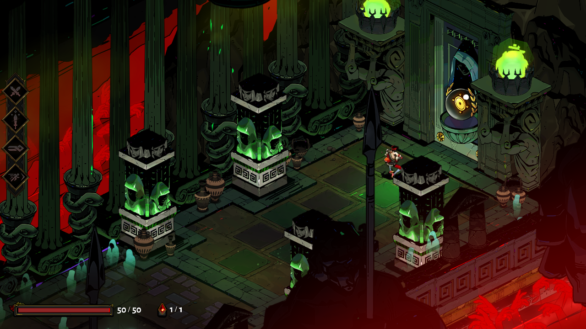

# SwitchGamesRecomp

Static recompilation of Nintendo Switch 1 games (AArch64) to native PC, CPU and GPU. First target: **Hades** (Supergiant, 0100535012974000).

No game data here. Everything derived from the game, keys and firmware stays in `private/` (gitignored). Bring your own legally dumped copy.

## Status

**Hades runs natively on PC, from boot to gameplay**: the CPU code is recompiled (main + Nintendo's SDK, 3.0M AArch64
instructions), the game's own Vulkan renderer (The Forge) runs on the host GPU through generated bridges, no
emulation anywhere. RTX 3050 laptop, 1280x720, 143 fps (vsync).

| Logo | Main menu |
|---|---|
|  |  |
| **Intro** | **Gameplay** |
|  |  |

Next: audio output, native resolution, C++ exceptions, a full run through the game. See the phase issues.

## Approach

Hades' `main` module imports everything it needs from the system by name: libc/libc++, `nn::*` SDK functions and **Vulkan** (100 `vk*` entry points; `subsdk0` is Nintendo's Vulkan driver). So:

1. **CPU:** recompile `main` (AArch64) to C++ with our own recompiler (`recomp/`).
2. **System:** implement main's imports natively on the host (`nn::os`, `nn::fs`, `nn::hid`, `nn::audio`, ...), like ReXGlue does with Xbox 360 kernel exports.
3. **GPU:** pass Vulkan calls through to the host driver. No Maxwell/NVN emulation.

Both sides are little endian, so no byte swapping. Details in [docs/FINDINGS.md](docs/FINDINGS.md).

## Phases

| Phase | What |
|---|---|
| 0 | Extraction and analysis |
| 1 | AArch64 → C++ recompiler: functions, jump tables, NEON, atomics |
| 2 | Runtime: loader, memory, threads, nn:: HLE |
| 3 | Vulkan passthrough: first native pixels |
| 4 | Audio, input, stability, full game |

## Extraction

```powershell
nstool -x / private\extract\upd_nsp "private\update\<update>.nsp"
nstool -k private\keys\prod.keys --tik <update .tik> -x /0 private\extract\exefs <update program .nca>
python tools\nso2bin.py private\extract\exefs\main private\analysis\main.bin
```
