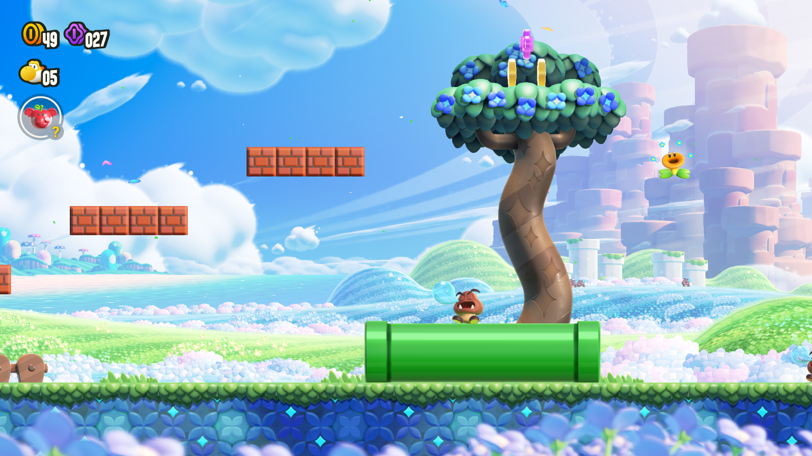

# Debugging the NVN → Vulkan path (continued)

Continues [DEBUG.md](DEBUG.md) (entries 1-58) from entry 59. The environment variables are in
[SWITCHES.md](SWITCHES.md). Milestone W7 on
GitHub (issues #43-#48): the glitches in the user's recording of course 1-1 (`docs/media/wonder/glitches/`) and
60 fps.

## Bugs found this way (2026-09-30, W7), in order

59. **The game's CPU waits did not cover a submit still being replayed (issue #43, `nvn_queue.cpp`).**
    - The game records frame N+1 on one thread while another thread is inside `nvnQueueSubmitCommands` for frame N.
      Our replay runs inside that call.
    - `nvnSyncWait`, `nvnQueueFinish` and pool invalidate/finalize returned at once there: `gpu_serial()` is 0, and
      the replay-thread job is inline. So the game could rewrite vertex and uniform data that the replay had not read
      yet. This is the leading cause of the horizon band and the exploded meshes (`glitches/play-012`, `play-044`).
    - Now there are two counters, submits called and submits done (a mutex and condition variable, never the GPU
      lock):
      - a fence records the submits made before it;
      - a sync wait blocks until those are done;
      - `QueueFinish`, `MemoryPoolInvalidateMappedRange` and `MemoryPoolFinalize` wait for every submit made so far.
    - Each wait gives up after 2 s, and the timeout is logged. The log also prints how many waits blocked (`CPU waits
      blocked on a submit still being replayed`). The course run had one.
    - `NX_SYNC_LOOSE=1`: the old behaviour.

60. **Depth EQUAL colour pass after a pre-pass: a small depth bias toward the camera (issue #44, `nvn_raster.cpp`).**
    - The colour pass tests EQUAL (taken as LESS_OR_EQUAL since #13) against depth written by a pre-pass that uses a
      different vertex shader. Metal compiles the two separately. Where the colour pass lands a few ulps behind, the
      pixel keeps the pre-pass's (0,0,0,1): black silhouettes and black/white wedges on slopes (`play-019`).
    - Pipelines with EQUAL, depth tested and not written enable depth bias. At each draw they get the game's bias
      minus `NX_EQUAL_SLACK` units (default 4), minus a quarter of that per unit of slope, with no clamp.
    - It only lets through what lies within that distance of the surface the pre-pass kept. `NX_EQUAL_SLACK=0`: off.

61. **Pipelined fences on by default (issue #46, `nvn_frames.cpp`; PERF-PLAN step 3): course 50 → 60 fps.**
    - A submit with dispatches is split after its last `DispatchCompute`. The first part is queued at the split,
      while the rest is still being replayed. Only its fence is waited for, and the write-backs are copied before
      `gpu_submit` returns, so guest memory holds the compute results exactly when it does synchronously.
    - The fence of the rest, and of the frame, is never waited for. At most 2 submits are in flight.
    - Review fixes applied before turning it on:
      1. The upload ring wrapping over its own submit waits for that submit's first part (the GPU may still read it).
      2. A first part that failed to queue drops the submit's write-backs (they would copy unwritten buffers over
         guest memory). A rest that failed to begin is not queued.
      3. A draw that binds storage over a written region (it may write the copy) counts like a compute binding.
         The write-backs then wait for the whole submit.
      4. The throttle (oldest submit waited for) runs after the rest is queued. Before, the rest waited behind it.
    - Log: `pipelined: 60 submits, 60 split (first part: 75% of the replay), write-backs after the first part 60`.
    - Course 1-1 headless:

      | Mode | fps |
      |---|---|
      | synchronous | 48-58 |
      | pipelined | 57-60 |
      | with #62-#64 | 60.0 steady |

    - Images match the synchronous run (animation phase aside).
    - `NX_PIPELINED=0`: the synchronous path; `NX_PIPELINED=3|4`: more submits in flight.

62. **Windowed present mode: MAILBOX, else IMMEDIATE, FIFO last (issue #47, `nvn_vk.cpp`).**
    - FIFO waited for the display's refresh while the game paced itself on its own 60 Hz vsync event: two clocks
      drifting against each other.
    - IMMEDIATE is now preferred over FIFO when MAILBOX is missing. On macOS, IMMEDIATE only removes the Metal
      layer's display sync; the compositor still shows whole frames.
    - The chosen mode is logged (`present mode ...`).
    - With pipelined fences, the blit's fence is not waited for either (`vkQueuePresentKHR` waits on the semaphore).
    - `NX_FIFO=1`: FIFO.

63. **Replay marks: dropped snapshots and sampler slots (issue #48).**
    - `drop_snapshot` erased the snapshot copy without `note_replaced`. A replay whose mark predates the new
      registration resolved the slot to that snapshot key and found nothing. Now the copy is noted as retired: it
      stays alive in the deferred list until the replay floor passes it.
    - Sampler pool slots had no history. A sampler re-registered with other state mid-replay was seen early. Now
      changes are recorded (only when the state differs: re-registering the same sampler every frame records
      nothing), and `sampler_entry_at` resolves the slot at the mark.
    - Regression caught in the course run: a slot **empty** at the mark fell back to `SamplerInfo{}` (nearest,
      clamp, `maxLod` 0.25, the #50 bug). The ground lost its grass and turned black past the brick stair. NVN reads
      descriptors when the GPU runs, so the game may register a slot after recording the lists and before
      submitting. An empty slot at the mark now uses the current entry.

64. **A texture slot or object empty at the mark resolves to the current one (issue #45, flat green silhouettes).**
    - The same rule as #63, for texture pool slots (`pool_entry_at` returned the "no texture" entry) and for objects
      (`find_object` returned null for an object created after the mark but before the replay). Both fell to the
      zero dummy for a few frames: the leading hypothesis for the flat green layers (`play-017`, `play-069`).
    - `NX_MARK_EMPTY_OLD=1`: the empty entry, as before, for bisecting. Confirmation needs a windowed run (the
      silhouettes were never seen headless).

    

## W8 (2026-09-30, night)

65. **Button icons showed as "?" (issue #49): our own NintendoExtended font.**
    - The game draws button icons as Private Use Area characters of shared font 5 (NintendoExtended). `hle_pl.cpp`
      gave it Arial Unicode, which has none of them. The console's fonts (system archives 0100000000000810-814 of
      firmware 23) are key generation 23, and our keys stop at `master_key_15`.
    - The codepoints come from the game's own text (`Mals/*/Key.msbt` labels):
      - E0E0-E0E9: A, B, X, Y, L, R, ZL, ZR, SL, SR;
      - E0EF / E0F0: Plus / Minus;
      - E0AB-E0AE, E0EA: the D-pad;
      - E100 / E101: the sticks;
      - E090-E097: the directions;
      - also the older E0A0-E0A9 set and E145/E146 (seen in layouts only).
    - The title is "Press <10.14:08cd> + <10.14:09cd> to Start": L + R.
    - `tools/fonts/make_button_font.py` draws those glyphs (our own vector shapes; only the letters inside come from
      the host font). It writes `private/wonder/fonts/shared_5.ttf` (git-ignored: it embeds the host font), which
      `hle_pl.cpp` already loads first.
    - Check: the title reads "Press [L] + [R] to Start", and menus show "(B) Back (A) Select".
    - To build it: `private/venv/bin/python tools/fonts/make_button_font.py`.

66. **Windowed stretches at 35-40 fps (issue #51): the GPU goes past the frame, headless does not.**
    - In the play session log, the slow stretches in the course show:
      - replay 8-10 ms;
      - `fence wait` 13-15 ms: all of it the wait for the first part of the split submit, with no throttle waits;
      - 60 of 60 submits split.
      So the GPU takes ~25 ms per frame there.
    - The same course headless: replay ~6 ms, fence ~4 ms, 60 fps. Audio is not the difference: the renderer runs
      headless too, only the output is dropped.
    - A windowed test run cannot measure it unattended. When the window is covered, SDL reports it hidden and
      `gpu_present` stops (`window_minimized`).
    - Next, with the window visible: `NX_GPU_PROFILE=1` in the slow stretch; `NX_PIPELINED=3`; and a check of whether
      the compositor holds the 3 swapchain images (IMMEDIATE, 2560x1440).

67. **World map: the player was a flat silhouette (issue #50). A pool swizzle leaked from another slot.**
    - The map draws the player into a target of its own. It then composites the player over the scene
      (fs `0bebd775`) from three textures:
      - A (RG16F): the player's distance and silhouette strength, written by fs `0030c911`;
      - C (R32F): the scene depth made linear by fs `0aa56d1b`;
      - P: the player colour.
    - Where `A.x >= C.x + 1e-5`, the player is behind the scenery: dark overlay. Otherwise P is shown.
    - Measured in one frame (new `NX_SNAP_RAW`): A.x and C match within 4e-6 at every player pixel. The shader
      still took the "behind" branch.
    - Cause: the game also registers A in another pool slot with a G G G G view. `TexturePoolRegister` stored that
      swizzle on the Texture (`pool_swizzle`). `sampled_view` applied it to every slot whose own view has no swizzle,
      the composite's included. A.x then read the strength (1.0), not the distance.
    - Fix (`nvn_pipeline.cpp` `sampled_view`): a slot's own view decides. `pool_swizzle` stands in only when no slot
      view is known. `NX_POOL_SWIZZLE_ANY=1`: as before.
    - Ruled out on the way, each kept as an opt-in switch:
      - depth invariance of GREATER (`NX_GREATER_SLACK=1`);
      - clip-space z convention: `NX_CLIP_Z_PATCH=1` maps z in the vertex shaders (`nvn_spirv_clip.cpp`) instead of
        using VK_EXT_depth_clip_control. It gives the same image, so MoltenVK's extension works.
    - Kept on: a pass that samples its own depth image while neither testing nor writing depth now runs without it
      attached (undefined on Metal). `NX_KEEP_SAMPLED_DEPTH=1`: as before.
    - Debug tools added:
      - `NX_SNAP_RAW=1`: 4-byte formats snapshotted as stored, to `.raw`;
      - `NX_SNAP_FS_MAX`;
      - `NX_TRACE_FS_HASH` takes a list;
      - `NX_TRACE_VERTS=1`: the first vertices of stream 0.
    - In the draw trace, the indented state lines come *before* the `draw N:` line they belong to.
    - Check: the map shows the chosen character. The course is still 60 fps, and menus and "Here we go!" are
      unchanged.

## Windows (2026-09-30, the PC: RTX 3050 laptop + Intel UHD 770; WINDOWS-PLAN.md)

68. **The data packs had no `spirv/results.tsv` (all storage buffers of translated shaders unbound).**
    - `tools/pack_phone_wonder.py` packs only `*.spv`, and `pack_pc_wonder.py` reuses it. On the phone and on the
      first PC boot the log said `no private/wonder/spirv/results.tsv: storage buffers of translated shaders cannot
      be bound`: every compute and vertex shader that reads a storage buffer read nothing.
    - Fix: both packers require and pack it. On the PC it was regenerated with the harness (TRANSLATOR.md, "Setup
      (Windows)"); `shader_cache_test` checks it against every `.spv`.
    - The Android build has the same hole: rebuild its data zip.

69. **NVIDIA: the process died in the driver at the title (`c0000094`, divide by zero in `nvoglv64.dll`).**
    - The Windows crash handler now names the module and unwinds the host stack (`host #n <module>+<offset>`;
      `tools/symbolize.py` for the exe's own frames). The stack was `image_of` → `vkCreateImage`.
    - Cause: an ASTC texture (NVN 0x87, ASTC 4x4 sRGB). Desktop NVIDIA GPUs have no `textureCompressionASTC_LDR`;
      creating an image in an unsupported format is undefined behaviour, and this driver divides by zero.
    - Wonder ships ASTC widely: the title's key art and logo (4x4) and the models' albedo maps (6x5).
    - Fix 1 (`nvn_image.cpp` `image_supported`): every image is checked with
      `vkGetPhysicalDeviceImageFormatProperties` first. Unsupported storage/attachment usages are dropped; an
      unsupported format is logged once and the texture keeps no image.
    - Fix 2: without the feature, ASTC textures are RGBA8 (sRGB or not) images, decoded on the CPU at upload by our
      own decoder (`nvn_astc.cpp`, from the Khronos specification). `nvn/vk: ASTC decoded on the CPU: n textures,
      MB, ms` is logged. `NX_ASTC_DECODE=1` forces it on a GPU that has ASTC (the Intel UHD 770 does: CPU and
      hardware decoding can be compared on the same GPU).
    - Tests: `astc_test --selftest` (void extent, reserved modes, 280,000 random blocks at all 14 footprints) and
      `tests/astc_check.py`: 29 of the game's textures (4x4 and 6x5, 4x4 to 1920x1080) match an independent decoder
      within 1 per channel on 100% of texels.
    - Check: the title on the RTX 3050 has its key art and logo; against the Mac's `37-title.png` only the animated
      parts differ (logo shine, scrolling checkers).

70. **The first Vulkan device was the integrated GPU.** On the laptop the loader lists the Intel UHD 770 first.
    `NX_GPU=discrete|integrated|<index>|<name part>` chooses (`nvn_gpu_pick.cpp`); the default is the first discrete
    GPU. Every device and the choice are logged. `gpu_pick_test` covers the rule (it caught `NX_GPU=3050` being read
    as an index).

71. **No barrier between render passes: the course HUD in blocks on NVIDIA, a black sky on Intel.**
    - Symptoms: on the RTX 3050 the HUD (coins, lives) had rectangular holes that changed every frame; on the UHD 770
      with `NX_ASTC_DECODE=1` the sky was black with green edges and a stretch of ground was garbage. Neither showed
      synchronously on the Mac, nor on the UHD 770 with its own ASTC (timing).
    - Cause: rendered images stay in `GENERAL` (they are sampled while rendered), so `transition()` records no
      barrier, and `pass_end_only` ended a pass with none either. The next pass sampled, copied or loaded what the
      last one wrote with no dependency. Metal (MoltenVK) tracks those hazards itself; NVIDIA overlaps passes and
      read half-written tiles.
    - Fix (`nvn_draw.cpp` `pass_end_only`): a memory barrier after every pass, from the graphics stages' attachment
      and shader writes to all later reads and writes. `NX_NO_PASS_BARRIER=1`: none, as before.
    - Cost: none measurable (course 58 fps headless on the RTX 3050, as before).
    - Check: the HUD is whole in every frame of the course on both GPUs, and the sky is right with the CPU decoder.

72. **Scene loads wrapped the upload ring over themselves: black and green characters in the opening's cast scene.**
    - Symptoms (RTX 3050, and the UHD 770 with `NX_ASTC_DECODE=1`; never with native ASTC): at the Flower Castle the
      Toads' bodies black with sparkles, Mario's and Luigi's faces black with green eyes, Daisy green; once a GPU
      hang. Gameplay was fine.
    - Bisecting: decoding only the linear or only the sRGB ASTC formats was right; an artificial delay on native
      uploads was right (not a race); the log had `upload buffer full (312 MB in this submit)` (the per-frame upload
      averages hid it).
    - Cause: the cast loads every character at once. Decoded to RGBA8 (4x to 9x the ASTC size) its textures staged
      312 MB in one submit through the 256 MB ring, which then wrapped over its own data before the GPU copied it.
    - Fix (`nvn_frames.cpp` `staging_alloc`, `nvn_upload.cpp`): texture uploads of 1 MB and more get a host-visible
      buffer of their own, freed when the submit being recorded retires (as images in the grave).
      `NX_STAGING_RING=1`: through the ring, as before.
    - Bisecting switches kept: `NX_ASTC_DECODE=linear|srgb|<hex format>,...`.
    - Tests: `tests/astc_check.py` now compares every mip level and the linear ASTC formats too (32 textures of the
      cast's models: all within 1 per channel). Check: the cast scene is whole on both GPUs (`tools/wonder_course.ps1`).

73. **Pipelines compiled in the replay: stutters when new objects come in; an on-disk pipeline cache.**
    - The course's slow windows had 10-42 ms replays where new objects appeared: `vkCreateGraphicsPipelines` runs
      the first time a draw needs a pipeline, inside the replay.
    - `nvn_pipeline_cache.cpp`: a `VkPipelineCache` loaded from `<data root>/pipelines_<vendor>_<device>.bin` and
      saved every 600 presents when it grew (the driver validates the header). `NX_PIPELINE_CACHE=0`: none.
    - A new line per 60 frames: `created over 60 frames: n pipelines (ms), n ASTC textures decoded (ms)`.
    - Measured (RTX 3050, course run with a warm cache): 853 pipelines in 1.2 s in all; 383 ASTC textures decoded
      in 3.8 s in all, about 10 ms each on the replay thread: the next cost to cut (#74).
    - `nvn_pipeline.cpp` went over 700 lines: the stand-in images moved to `nvn_dummy.cpp`.

74. **Audio: the limiter crash at boot again on Windows (issue #16, DEBUG.md #28).**
    - `CRASH ... sdk+228220` (the limiter's apply) under `CommandListProcessor::Process` 3 s into one run of ~25.
    - An update waits for a render since the previous one, but gave up after 50 ms; with every thread loading at
      boot a render can take longer, and a second update then overwrites the effect's initialize status.
    - Now it waits up to 1 s and logs `audio: no render for 1 s since the last update` if it gives up. 12 boots in a
      row: no crash, the log line never printed. To watch: any further crash with that line before it.

75. **ASTC decoding over a few threads.** Images of 8,192 blocks and more are decoded by up to 6 threads, by rows of
    blocks (`nvn_astc.cpp`). Course run on the RTX 3050: 379 textures decoded in 2.4 s in all (3.8 s on one thread);
    `astc_test` and `astc_check.py` still pass. With the warm pipeline cache, pipelines cost 0.36 s in all (1.2 s
    before the cache had filled). Course median 58 fps headless.

76. **Exploded meshes in course 1-1 on Windows: the pipelined path. Synchronous by default off macOS.**
    - The owner's play session (RTX 3050, windowed, pipelined): long black lines across the screen, stretched
      triangles around the ground and bushes near Elephant Mario, a goal house turned into a sheaf of streaks
      (`private/wonder/play2`, a frame every 5 s; `tools/find_glitches.py` flags them by near-black pixels in bright
      scenes).
    - Scripted runs did not show them: with Parsec taking ~70% of the CPU the game ran at 30 fps and the timing
      changed. So the A/B ran with the owner playing: the same course with `NX_PIPELINED=0` (and 1-2 after it) had
      none (`private/wonder/play3`, a frame every 2 s), at a 58 fps median against 40 for the pipelined session.
    - So it is the overlap of frame N's GPU work with what the game does next (the Mac's #43 "exploded meshes" is
      likely the same). The pipelined path was made for MoltenVK, which encodes Metal inside `vkQueueSubmit`; native
      drivers do not need it.
    - Fix (`nvn_frames.cpp` `pipelined()`): on by default on macOS only. `NX_PIPELINED=1..4` turns it on elsewhere
      (to find the race itself, which is still open for the Mac).
    - Tools: `tools/wonder_course.ps1 -Course11` goes on through the opening and the map into course 1-1;
      `NX_GPU_PROFILE` logs the frame's GPU total.

77. **World map: every other frame broken while Mario walks (open), and the limiter crash at boot once more (#74).**
    - The owner's recording (map, after playing courses): while Mario moves, about half the frames show a flat
      lavender scene, huge black triangles and Mario as a purple silhouette; standing still is fine.
    - Not reproduced from a boot straight into the map (headless at 14 fps, windowed at 59 fps with
      `tools/capture_burst.ps1` taking 116 window captures while a script walked Mario back and forth): it needs the
      state of a longer session.
    - Tool for that: a file named `dump_frames` in the data folder (`"<count> [<every>]"`) dumps the next presented
      frames at full speed (`nvn_debug.cpp` `frame_dump_due`).
    - #74 again: a render that began before an update and ended after it counted as a render that used it. The update
      now records the render count after it ran, under the render lock, and renders count themselves under it.
      20 boots in a row: no crash.
